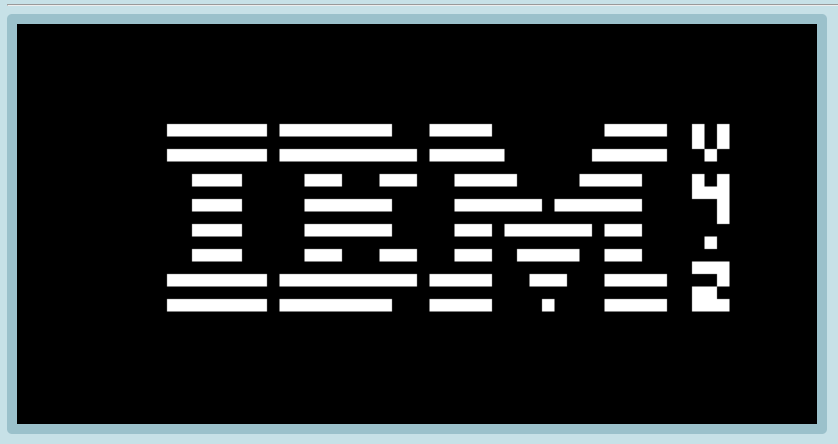
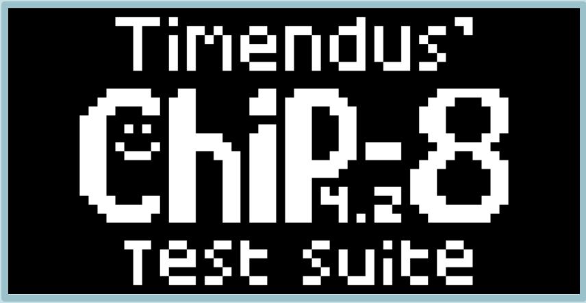
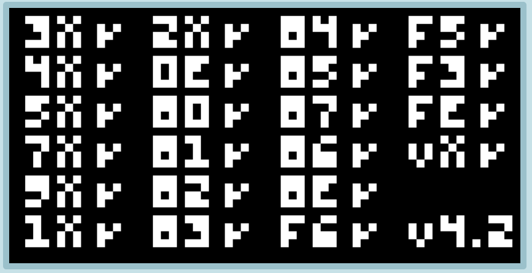
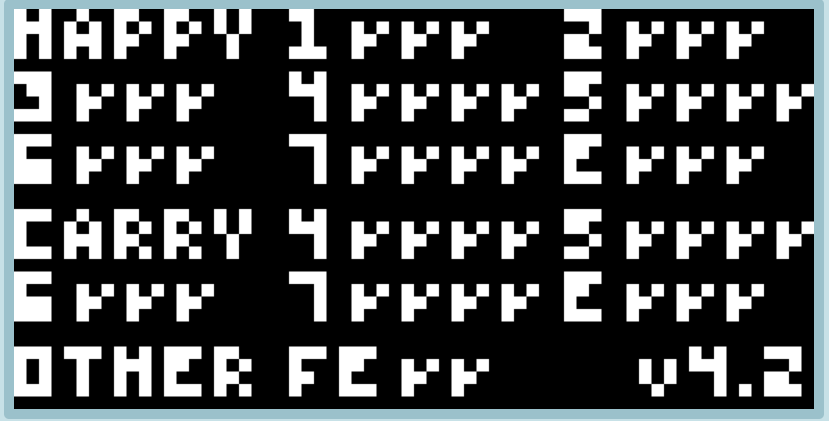
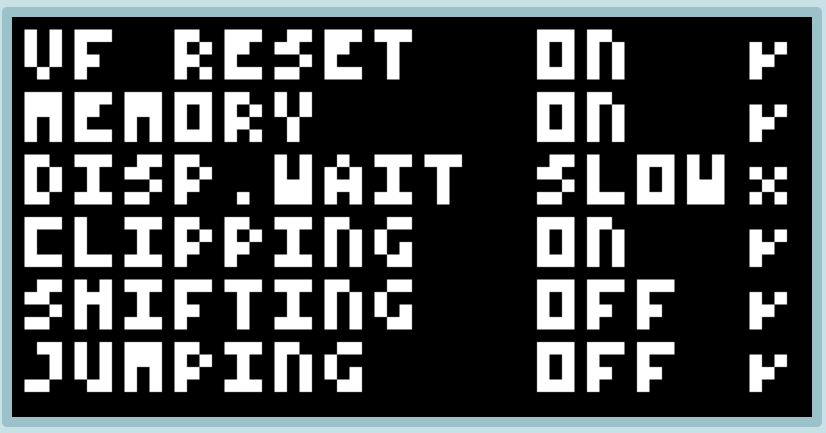
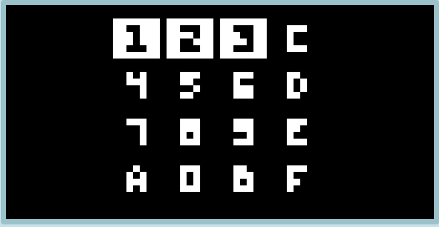
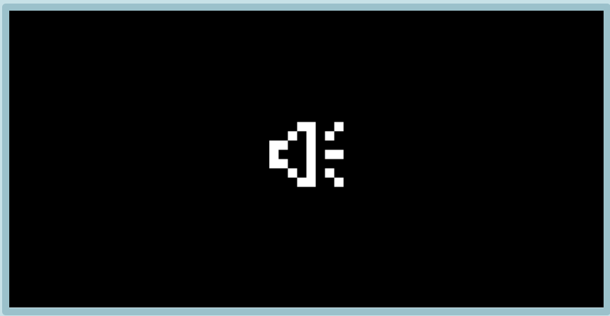
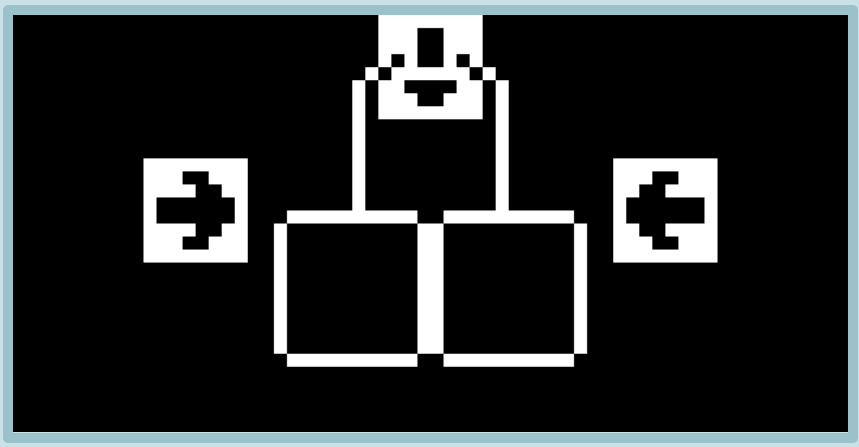

# Chippy8

## A CHIP8 Emulator written in JavaScript

"never use UInt16Array again" -ben

All CHIP-8 Specifications as accurate as possible.

All instructions implemented mostly accurateish.

Example/Demo:
[chippy8.ben3coder.dev](https://chippy8.ben3coder.dev)

- help from: [https://tobiasvl.github.io/blog/write-a-chip-8-emulator/#6xnn-set](https://tobiasvl.github.io/blog/write-a-chip-8-emulator/#6xnn-set)

## Examples Roms
All CHIP8 Suite test roms belong to CHIP8 Test Suite under GPL v3
| Program | Example running on Chippy8 |
| -- | -- |
| 1-chip-logo.ch8 |  |
| 2-ibm-logo.ch8 |  |
| 3-corax+.ch8 |  |
| 4-flags.ch8 |  |
| 5-quirks.ch8 |  |
| 6-keypad.ch8 |  |
| 7-beep.ch8 |  |
| 8-scrolling.ch8 (meant for SUPER-CHIP/etc.) |  |

## How the development went

The boilerplate for everything was relatively easy, but once I started doing the programming for the emulator I made some mistakes that
catched on later when I was implementing the other instructions like not including a index register or a program(?) register and a screen
that was broken but looked fine to me. I also used the wrong type of array which skipped every other byte. Other than that, the instructions
being implemented were straightforward with the guide that was provided in the guides tab for emulator and was pretty challenging at some parts
which I did like but overall would write another emulator after this one is finished.

Part 2 (next day)
Implementing most of the new instructions were straightforward at first, but when I started running the test rom and looking at the code for it I saw that there were
many dumb mistakes I accidentally made at the start or during the instructions which all added up but I believe I have fixed most of the errors.
All instructions have beeen implemented to pass the corax test, but it is not fully accurate (as shown with flags)
Keyboard working kinda right now but need to allow multi press and still need audio and acccurate instructions

Part 3 (final day before ship crunch time)
implementing the flags instructions were quite weird kinda took a bit but not hard just weird on how math works lol
all flag instructions implemented successfully and accurate? enough.
Took 4 days from oct. 8 -> oct. 12. (most work done on friday -> sunday)

## Goal (what is missing)

- Good looking ui (for the example & iframe)
- Easy modularity to be used in other projects
- 100% accuracy (kindaish done)
- Adjustable accuracy
- Adjustable clock speed
- IFrame-type embedding to run a file ([https://example.com/embed?file=FILE](https://example.com/embed?file=FILE)) or a api like `const chippy = new Chippy8(canvas, options);`
- Much better code comments hopefully

## Statistics/Compatability (what runs)

- Mostly accurate CHIP-8 Emulation (no SUPER-CHIP/etc.)
- All test programs run (except for the 8-scrolling.ch8 as it is a CHIP-8 not etc)
- Corax all passing
- Flag all passing
- Quirks passing all but disp.wait
- 35/35 instructions implemented
- Non-cycle accurate (700/s (not yet adjustable))

